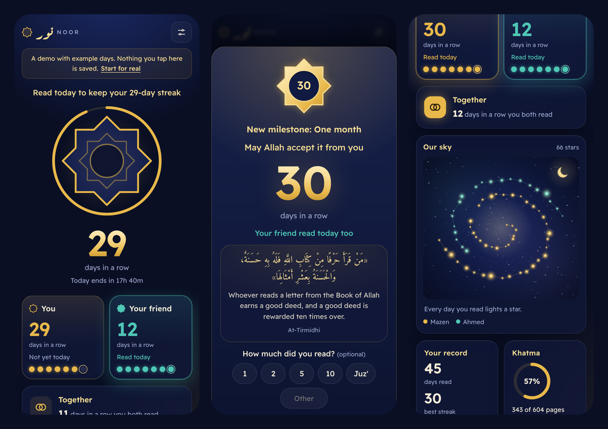

# Noor · نور

Read Quran every day, together. Read on your own, then open Noor and tap the star. Your streak grows, your friend
sees it, and every day you read lights a star in a sky you build together.

**Open it:** [mazenelnaghy-code.github.io/quran-streak](https://mazenelnaghy-code.github.io/quran-streak/) ·
**Try it with example days:** [the demo](https://mazenelnaghy-code.github.io/quran-streak/#demo)



## What it does

- **One tap after you read.** The ۞ star fills with gold, sparks fly, and a soft chime plays. You see
  «من قرأ حرفًا من كتاب الله فله به حسنة، والحسنة بعشر أمثالها» and can note how many pages you read.
- **Streaks.** Your streak, your best streak and your friend's streak. "Read today to keep your 12-day streak"
  shows how long is left in the day. Forgot to tap yesterday? Mark yesterday and the streak comes back.
- **Together.** A shared streak counts the days you both read. If Noor is open when your friend reads, you see it
  right away. If you've read and they haven't, the Remind button opens WhatsApp with a reminder ready to send.
- **Your sky.** Each of you is one arm of a spiral galaxy, and every day read is a star on it. Days in a row are
  joined like a constellation, and days you both read glow gold.
- **Milestones.** Badges at 3, 7, 14, 30, 40, 60, 100, 200 and 365 days, with a ring showing how close the next one is.
- **Khatma.** The pages you note add up toward a full reading of the mushaf's 604 pages.
- **A reminder every day.** A verse or hadith about reading the Quran, in Arabic with an English translation.
- **English and Arabic,** right to left, with Arabic counted nouns done properly (يوم، يومان، أيام، يومًا).
- **Works like an app.** Add it to your home screen and it opens full screen and works offline. A day ends at 3 AM,
  so reading after midnight still counts for the evening before.

## Read with your friend

Until sharing is switched on, Noor keeps each person's streak on their own phone. Sharing uses a free Firebase
project and takes about five minutes:

1. Go to [console.firebase.google.com](https://console.firebase.google.com), create a project called
   `quran-streak` and turn Google Analytics off.
2. Open **Firestore Database** and click **Create database**. Choose the Standard edition if asked, any location
   (for example `eur3`), and **production mode**.
3. In the database's **Rules** tab, replace everything with the contents of [`firestore.rules`](firestore.rules)
   and click **Publish**.
4. Open **Project settings** (the gear), scroll to **Your apps** and click the web icon **</>**. Name it Noor
   and register it. Firebase shows a `firebaseConfig` with your project's settings.
5. In this repository, edit [`config.js`](config.js): replace `null` with that object, so the line reads
   `window.NOOR_FIREBASE = { apiKey: "…", authDomain: "…", projectId: "…", storageBucket: "…", messagingSenderId: "…", appId: "…" };`
   and commit.
6. Open Noor, tap **Read with a friend**, and send your friend the link. Your days so far come with you.

These web settings are meant to be public; what protects the data is the rules file.

## Privacy

There are no accounts and no tracking. A circle stores each member's name, colour and the days they read with the
number of pages. Anyone who has a circle's invite link can see and join that circle, so share it only with your
friend. The links can't be guessed (20 random characters), and circles can't be listed or searched. The rules also
stop anyone from adding other fields, renaming a circle or deleting a member.

## How it's built

A static site on GitHub Pages with no build step: plain JavaScript modules, CSS and canvas.

| Part | Where |
|---|---|
| Streak maths: reading days, streaks, the shared streak, milestones, khatma | [`js/logic.js`](js/logic.js) |
| The screens and the check-in | [`js/app.js`](js/app.js) |
| The sky, drawn on a canvas | [`js/sky.js`](js/sky.js) |
| Sparks, the chime (made in the browser with the Web Audio API) and vibration | [`js/fx.js`](js/fx.js) |
| On this phone only, or shared through Firestore with live updates and offline support | [`js/store.js`](js/store.js) |
| English and Arabic | [`js/i18n.js`](js/i18n.js) |
| Verses and hadith | [`js/reminders.js`](js/reminders.js) |
| Security rules | [`firestore.rules`](firestore.rules) |
| Offline support | [`sw.js`](sw.js) |

`vendor/firebase.js` is the part of the Firebase JavaScript SDK 13.1.0 that Noor uses (Firestore), bundled with
esbuild so the site loads it from GitHub Pages. The SDK is Apache-2.0 licensed; its notices are at the end of the file.

## Tests

```bash
node --test
```

The tests cover the 3 AM day boundary, streaks across gaps, months and leap years, the shared streak, milestones,
khatma pages and Arabic counted nouns. Sharing was tested on two simulated phones against the Firestore emulator
with these rules: starting a circle, joining from the link, seeing each other's check-ins live, and moving to a new
phone with a personal link. The rules were also checked to refuse listing circles, extra fields, long names,
changing a circle and deleting a member.

Verse translations follow Sahih International.

Built by [Mazen Elnaghy](https://github.com/mazenelnaghy-code).
